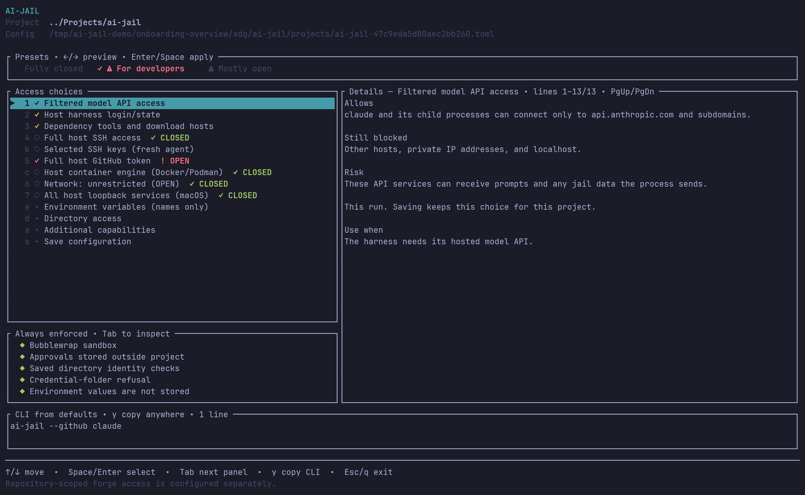
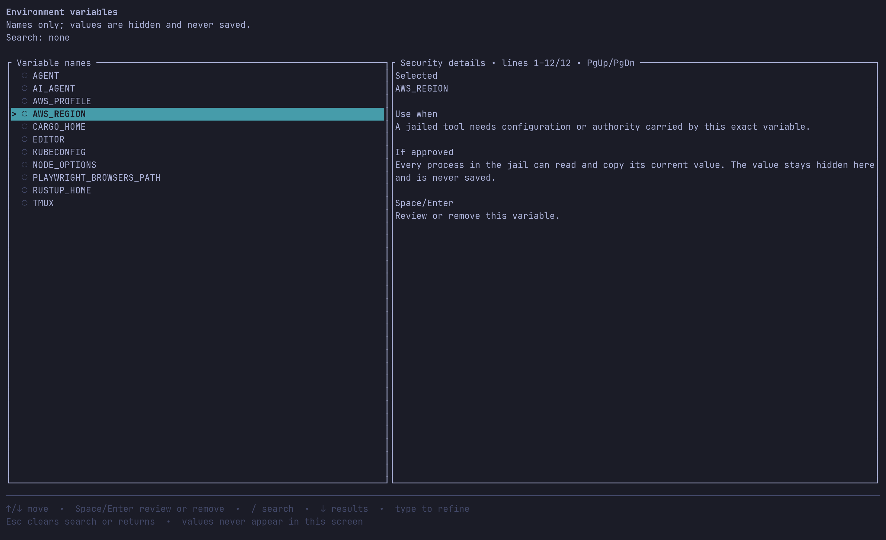
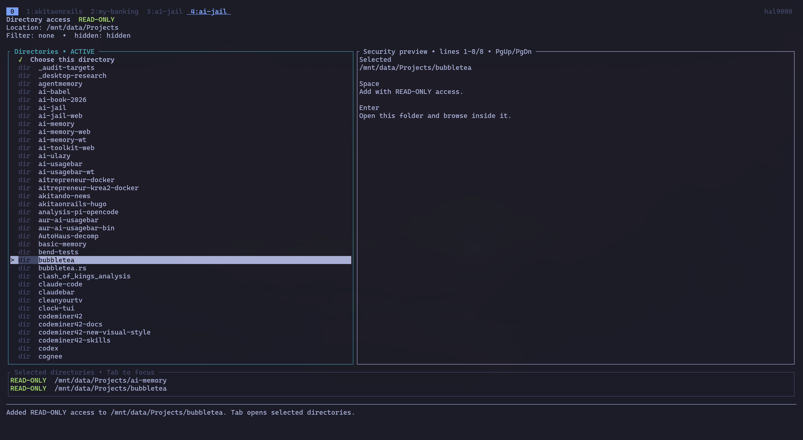

# ai-jail

**[aijail.io](https://aijail.io)**

`ai-jail` runs AI coding agents in an OS sandbox: bubblewrap plus Landlock,
seccomp, and limits on Linux; `sandbox-exec` on macOS.

## What ai-jail is (and isn't)

ai-jail is **not** a lockdown or hard-security tool, and it is **not** a
boundary against malware or other hostile code — for that, use a disposable
VM. Its job is to be **developer-friendly**: it defends against a
trusted-but-fallible agent's mistakes, not against a motivated attacker
actively trying to escape.

Concretely, the first run for a known harness now reviews host access before
anything is saved. Dev tools, harness login state, and network access are
separate choices. A saved grant is convenient, but it is not a
lockdown-secure posture; anything inside the jail can use the granted resource.
The goal is to prevent _accidents_: an LLM running a mistyped command that
deletes unrelated important files outside the project, for example. With the
project directory as the blast radius, you can confidently turn on "YOLO
mode" (auto-accept, no confirmation prompts) in an AI harness with reasonable
confidence it won't damage anything outside the project scope.

It is a useful accident-prevention layer, not a replacement for a disposable
VM when running hostile code. See [docs/SECURITY.md](docs/SECURITY.md) for
the full threat model.

## Install

```bash
# Homebrew
brew tap akitaonrails/tap && brew install ai-jail

# Arch Linux
yay -S ai-jail-bin       # prebuilt Linux x86_64 binary
yay -S ai-jail           # build from source

# Debian / Ubuntu (prebuilt .deb; Debian 12+ / Ubuntu 22.04+)
# download ai-jail_<version>_amd64.deb from the GitHub release, then:
sudo apt install ./ai-jail_<version>_amd64.deb

# crates.io
cargo install --locked ai-jail

# Nix (flake) — sets BWRAP_BIN automatically
nix run github:akitaonrails/ai-jail -- claude
nix profile install github:akitaonrails/ai-jail

# GitHub Releases (signed archives, checksums alongside)
# ai-jail-linux-x86_64.tar.gz / ai-jail-macos-aarch64.tar.gz
# ai-jail_<version>_amd64.deb (Debian/Ubuntu)
```

Build from source with Rust `1.97.1`:

```bash
cargo build --release --locked
install -Dm755 target/release/ai-jail ~/.local/bin/ai-jail
```

Linux requires `bwrap` (`bubblewrap`): `pacman -S bubblewrap`,
`apt install bubblewrap`, or `dnf install bubblewrap`. `BWRAP_BIN` is accepted
only when it canonically resolves to a root-owned executable that is not
group- or world-writable, or to an executable with no write bits under a
`/nix/store` whose own owner is root (or an unmapped owner inside a user
namespace), is not world-writable, and carries the sticky bit if it is
group-writable — the standard multi-user store layout, mode `1775`. A
group-writable store without the sticky bit is refused, because a group member
could then replace the binary. A single-user store owned by the invoking user
does not qualify either.
macOS uses Apple's deprecated `/usr/bin/sandbox-exec` interface. Windows is not
supported; use WSL2 and the Linux backend inside it.

## Quick start

```bash
cd ~/Projects/my-app
ai-jail claude                   # first run: review access, then launch
ai-jail --no-agent-state claude  # isolated, logged-out run instead
ai-jail --dry-run claude
```

The first `ai-jail claude` in a project opens one persistent terminal UI when
a capable terminal is attached. Its access list, security details, directory
browser, environment selector, and selected-key SSH editor stay inside the
same session. Wide terminals use split panes; narrow terminals stack the same
information. First-time onboarding applies the constrained
`For developers` preset: filtered model API access for the known harness,
harness login/state, dependency tooling, and the active host GitHub token. The
GitHub row is visibly OPEN because it carries every permission of that token,
not only the current repository. `Tab` only moves between the access,
always-enforced, and preset panels; it skips the read-only CLI preview and
never changes a setting.
The preset bar uses Left/Right to live-preview `Fully closed`, `For developers`,
or warning-marked `Mostly open` access before anything is applied; granular
changes become `Custom`. No preset guesses
arbitrary environment variables or extra directories; the visible
harness-state grant includes a detected well-known API key for that harness.
`Mostly open` requires an explicit dialog. The saved policy lives under
`$XDG_CONFIG_HOME/ai-jail/projects` (normally
`~/.config/ai-jail/projects`), outside the checkout. Use
`ai-jail configure claude` to review it later. The project directory remains
writable by default. On the access overview, `Esc` or `q` exits immediately
when nothing changed. With an unsaved draft, either key opens a dialog with
`Keep editing`, explicit `Discard & quit`, and `Save changes`. Saving from this
exit path does not launch the harness. After any save, ai-jail prints the exact
external config path so it can be reviewed later.

The main screen also shows the exact profile path and a live, read-only
`CLI from defaults`. It omits flags whose selected values already match
ai-jail's built-in defaults. Press `y` anywhere on the main screen to copy the
shell-safe command with the system clipboard helper. Environment values are
never copied; profile-only choices are called out instead of being silently
omitted. Existing global or project policy can still affect a copied command;
the compact preview describes choices relative to built-in defaults.



The main access view distinguishes constrained access from OPEN host authority.
Docker/Podman daemon control and unrestricted networking remain closed under
`For developers`; the GitHub row is visibly OPEN because the legacy host token
is not repository-scoped.

| Environment variables                                                                                                                                                                                | Additional directories                                                                                                                                                                    |
| ---------------------------------------------------------------------------------------------------------------------------------------------------------------------------------------------------- | ----------------------------------------------------------------------------------------------------------------------------------------------------------------------------------------- |
|  |  |
| Search names and approve only the variables needed. Values never appear in the selector or saved policy.                                                                                             | Browse with `Enter`, select with `Space`, switch to the selected pane with `Tab`, and toggle read-only/read-write with `m`.                                                               |

A first run without a terminal uses restricted defaults once and saves
nothing. `ai-jail configure` also requires a terminal and changes nothing when
run non-interactively. `--dry-run` never migrates or writes configuration.
Unreadable or invalid trusted configuration fails closed. `TERM=dumb` uses a
sequential plain-terminal fallback with the same security decisions. See the
[onboarding guide](docs/USER_GUIDE.md) for curated screen walkthroughs and the
[TUI design contract](docs/TUI_DESIGN.md) for implementation invariants. The
[CLI/TUI parity inventory](docs/CLI_TUI_PARITY.md) tracks which command-line
capabilities are exposed interactively and blocks undocumented drift.

Tool and wrapper developers can integrate without scraping terminal output.
The versioned [wrapper integration contract](docs/WRAPPER_INTEGRATION.md)
documents capability discovery, explicit harness identity, request manifests,
saved approvals, JSON status, exit codes, and the rules that keep a request
from becoming a grant. It is the same public contract used by `ai-memory` and
is available to any launcher or orchestration tool.

## Secure defaults

"Secure defaults" here means defaults tuned to stop accidents, not defaults
tuned to stop attackers — see
[What ai-jail is (and isn't)](#what-ai-jail-is-and-isnt). The project
directory is where the agent is expected to work; everything else on the
host is either hidden or exposed deliberately, capability by capability.

Devin CLI is recognized as `devin`. Its existing state under
`$XDG_DATA_HOME/devin` (default `~/.local/share/devin`) and configuration under
`$XDG_CONFIG_HOME/devin` (default `~/.config/devin`) are shared read-write,
including credentials and history. `--no-agent-state` disables this automatic
sharing. The self-managed installation under `devin/cli/_versions` stays
read-only, and its `cli` ancestor cannot be renamed from the jail; CLI metadata
outside `_versions` remains writable. If `cli` is entirely absent (as with an
external installation), credentials and history remain writable without a warning;
installation protection is not applied. If `cli` is present but invalid, or its
`_versions` is missing, unreadable, or a symlink, Linux shares the data root
read-only and macOS skips sharing it. Discovery never creates host directories.
Update Devin on the host and start a new jail session afterward. XDG base paths must exist:
relative values use the HOME fallback, existing bases are resolved physically
(including symlinks and `..`), and unresolved bases are skipped with one warning
per XDG variable per launch. `--no-agent-state` suppresses these XDG-base warnings.
On Linux, explicit writable maps or using the installation as the project
can override the automatic read-only mount. `--no-private-home` keeps the
existing broad home-sharing behavior; it is not equivalent to private-home
isolation.
When no network posture is selected, the existing agent API policy
default-allows `server.codeium.com` through filtered egress, unioned with any
explicit `--allow-host` list. To allow only explicitly named hosts, use
`--no-network --allow-host HOST`; `--no-network` without allowed hosts stays
fully offline. Lockdown and browser launches suppress these automatic defaults.
A custom Devin `--config` file outside the visible paths requires an explicit
`--map` or `--rw-map`.

```bash
ai-jail devin --permission-mode dangerous
```

### Baseline and approved profile access

- **Private home** — the agent gets a fresh tmpfs `$HOME`, not your host
  home.
- **Approved agent/harness auth (`agent_state`):** when selected during
  setup (or enabled explicitly), the invoked harness's own
  credential/state dir (for example `~/.claude`, `~/.codex`,
  `~/.kimi`, `~/.gemini`, `~/.kiro`) is mounted **read-write** so it starts
  pre-authenticated instead of asking you to log in every session; its
  known API-key env var (`ANTHROPIC_API_KEY`, `OPENAI_API_KEY`,
  `GEMINI_API_KEY`/`GOOGLE_API_KEY`, `XAI_API_KEY`, `MOONSHOT_API_KEY`) is
  also copied from the host when set. Anything running in the sandbox can use
  those credentials for the life of the launch. First-time interactive
  onboarding preselects this as part of `For developers`; review or disable it
  before saving if you want a logged-out jail. `--no-agent-state` forces an
  isolated, logged-out run.
- **Approved dev toolchains (`--toolchains`):** persistent, jail-owned dependency
  caches (cargo/npm/go/maven/...), the Rust toolchain mapped read-only,
  and, when the network posture is otherwise unset, filtered egress to
  package registries so a fresh `npm install`/`cargo build`/`go get` works.
  First-time interactive onboarding preselects this as part of `For
developers`. See [Dev toolchains](#dev-toolchains).
- **Approved mise integration:** the project's language versions are activated
  when the dependency-tool grant is active and mise is on `$PATH`. See
  [mise integration](#mise-integration).
- **Project directory** — read-write by default; `/tmp` inside the sandbox
  is writable (and discarded on exit).

### Off by default

network, GPU, KVM, display (Wayland), X11, audio, host shared memory, raw
terminal passthrough, the Docker socket, Tailscale, the systemd user bus,
SSH agent/key sharing, Pictures, linked Git worktree metadata,
`--inherit-env`, the update check, macOS host IPC, and four of the five
legacy credential flags (`--aws`, `--kube`, `--gcloud`,
`--docker-config`). The raw `--github` default is also off, but first-run
`For developers` visibly preselects it as OPEN — see
[Tool credentials](#tool-credentials). Mounting
agent state or any of these exposes that material to everything running in
the sandbox, which is why the first-run review keeps them as separate choices.
Use `--no-private-home`
only when deliberately granting broad host-home access; `--map` and
`--rw-map` remain explicit, narrow alternatives.

Fresh known-harness profiles preselect agent state, dependency tools, and the
known model API's filtered egress in the visible `For developers` preset. The
full host GitHub token is also preselected and visibly OPEN; final confirmation
is required. Completed profiles retain their saved choices.

| Flag pair                                                  | Effect and security consequence                                                                                                                                                                                                                                                                                                                                                                                             |
| ---------------------------------------------------------- | --------------------------------------------------------------------------------------------------------------------------------------------------------------------------------------------------------------------------------------------------------------------------------------------------------------------------------------------------------------------------------------------------------------------------- |
| `--network` / `--no-network`                               | Enables/disables unrestricted network. `--network` permits full network exfiltration of any readable data.                                                                                                                                                                                                                                                                                                                  |
| `--gpu` / `--no-gpu`                                       | Enables/disables GPU device access.                                                                                                                                                                                                                                                                                                                                                                                         |
| `--display` / `--no-display`                               | Enables/disables display access. Only the validated Wayland socket is mounted; ai-jail never mounts all of `XDG_RUNTIME_DIR`. X11 is separate (`--x11`).                                                                                                                                                                                                                                                                    |
| `--x11` / `--no-x11`                                       | Enables/disables X11 separately. X11 access permits keylogging and screenshots.                                                                                                                                                                                                                                                                                                                                             |
| `--audio` / `--no-audio`                                   | Enables/disables host audio (Linux only). Binds the validated PipeWire/PulseAudio sockets in `XDG_RUNTIME_DIR` plus `/dev/snd`; anything in the sandbox can record and play audio while enabled.                                                                                                                                                                                                                            |
| `--kvm` / `--no-kvm`                                       | Enables/disables `/dev/kvm` (Linux only) for hardware-accelerated VMs; exposes the host kernel's KVM ioctl interface. No `/dev/net/tun` or vhost devices; guests get only the sandbox's network.                                                                                                                                                                                                                            |
| `--host-shm` / `--no-host-shm`                             | Enables/disables host `/dev/shm`; enabling it opens host cross-process IPC.                                                                                                                                                                                                                                                                                                                                                 |
| `--terminal-passthrough` / `--no-terminal-passthrough`     | Enables/disables raw terminal forwarding. Output is filtered through a VT parser by default (window titles still pass, as printable text only); raw forwarding exposes terminal clipboard, query, and parser surface.                                                                                                                                                                                                       |
| `--agent-state` / `--no-agent-state`                       | The raw CLI/config default is off; first-run `For developers` preselects it visibly. When approved or passed explicitly, mounts the invoked command's credential state read-write (for example `~/.claude`, `~/.codex`) and copies its known API-key environment variable when set. Anything in the jail can use those credentials. `--no-agent-state` forces an isolated, logged-out run; `--lockdown` disables the grant. |
| `--inherit-env` / `--no-inherit-env`                       | Default is a minimal environment allowlist. `--inherit-env` passes the full parent environment, secrets included.                                                                                                                                                                                                                                                                                                           |
| `--update-check` / `--no-update-check`                     | Enables the status bar's outbound GitHub version check, run in a background thread while the interactive status bar is active (default off; all other launches make no network requests).                                                                                                                                                                                                                                   |
| `--macos-host-ipc` / `--no-macos-host-ipc`                 | Enables/disables macOS Mach, IOKit, and host IPC exposure.                                                                                                                                                                                                                                                                                                                                                                  |
| `--macos-chromium` / `--no-macos-chromium`                 | Enables/disables Chromium's own Mach rendezvous service on macOS (needed by headless Chromium and Playwright).                                                                                                                                                                                                                                                                                                              |
| `--macos-trustd` / `--no-macos-trustd`                     | Enables/disables only macOS `trustd` lookup so TLS clients like `gh` can verify certificates, without `--macos-host-ipc`.                                                                                                                                                                                                                                                                                                   |
| `--allow-pty` / `--no-allow-pty`                           | Allows opening PTY slave nodes allocated at runtime on macOS, for tools that spawn their own pseudo-terminals (`expect`, terminal multiplexers, `xcodebuild` driving an iOS Simulator). Grants every `/dev/ttys*`, so off by default and dropped under `--lockdown`; still far narrower than the `rw_maps = ["/dev"]` workaround. No effect on Linux (issue #209).                                                          |
| `--allow-loopback-listen` / `--no-allow-loopback-listen`   | Allows binding and listening on loopback under filtered egress on macOS, for tools that start a local `127.0.0.1` server, without dropping egress filtering the way `--network` would. Off by default, dropped under `--lockdown`. No effect on Linux (issue #213).                                                                                                                                                         |
| `--allow-loopback-connect` / `--no-allow-loopback-connect` | **OPEN, macOS only.** Allows outbound connections to ALL services on the host loopback interface, on every port. Off by default, trusted config/CLI only, and disabled by `--lockdown`. On Linux it is accepted for cross-platform config compatibility but has no effect. Prefer `--forward-port PORT` when one known service is sufficient.                                                                               |
| `--worktree` / `--no-worktree`                             | Enables/disables validated linked-worktree metadata. When enabled, the per-worktree git dir and the shared common dir are writable so the agent can commit; `--lockdown` keeps both read-only.                                                                                                                                                                                                                              |
| `--private-home` / `--no-private-home`                     | Enables/disables the default private home. Disabling it is broad host-home access.                                                                                                                                                                                                                                                                                                                                          |
| `--toolchains` / `--no-toolchains`                         | The raw CLI/config default is on; first-run `For developers` also shows it selected (Linux only; issue #148). It persists dependency caches (cargo/npm/go/maven/...) in a jail-owned store and maps toolchain binaries read-only; when network posture is otherwise unset, it also allows filtered egress to package registries. `--no-toolchains` disables both; `--lockdown` disables the grant; no effect on macOS.      |
| `--github` / `--no-github`                                 | **OPEN.** Shares gh configuration read-only and the active github.com token from the host. The raw CLI/config baseline is off; first-run `For developers` preselects it visibly and requires final OPEN confirmation. Sandboxed programs can act with the token's complete authority. Prefer repository-scoped `ai-jail forge setup`.                                                                                       |
| `--aws` / `--no-aws`                                       | Enables/disables read-only `~/.aws`. Off by default; anything in the sandbox can then act as you on AWS.                                                                                                                                                                                                                                                                                                                    |
| `--kube` / `--no-kube`                                     | Enables/disables read-only `~/.kube`. Off by default; anything in the sandbox can then act as you against your clusters.                                                                                                                                                                                                                                                                                                    |
| `--gcloud` / `--no-gcloud`                                 | Enables/disables read-only `~/.config/gcloud`. Off by default; anything in the sandbox can then act as you on GCP.                                                                                                                                                                                                                                                                                                          |
| `--docker-config` / `--no-docker-config`                   | Enables/disables read-only `~/.docker/config.json`. Off by default; anything in the sandbox can then push/pull as you against your registries.                                                                                                                                                                                                                                                                              |

When the invoked command itself lives under `$HOME`, its path is exempted
from the private home, and symlink chains along it are preserved as symlinks
inside the sandbox (regression: prime-agent/bun crashed with ENOENT
`package.json` when the exemption flattened the launcher symlink), so
symlink-following launchers keep resolving their app root. Only the terminal
real path is bind-mounted read-only.

### Turning it down

The saved posture can be developer-friendly: the project directory is
read-write, and you can approve harness state, toolchains, and filtered egress
for later launches.
From there you can turn individual knobs down, or jump straight to the
strictest mode:

- **Selective opt-outs** — `--no-agent-state` (no harness credentials
  mounted), `--no-toolchains` (no caches, no registry egress),
  `--no-network` (fully offline unless combined with trusted
  `--allow-host`, overriding automatic egress defaults), `--mask`
  / `--deny-path` (hide or deny specific project paths), `--hide-dotdir`
  (never mount a named dotdir), `--map` / `--rw-map` (scope extra mounts
  narrowly instead of a broad grant).
- **`--no-private-home`** goes the other way: it is **more** exposure, not
  less — the agent gets your real host `$HOME` instead of a fresh tmpfs one.
  Reach for it only when you deliberately want that, and prefer `--map` /
  `--rw-map` or a `[commands.<name>]` table for anything narrower.
- **`--lockdown`** — the maximum: read-only project directory, toolchains,
  agent-state, registry egress, and most other capabilities disabled, strict
  Landlock and seccomp. It is the closest ai-jail gets to a hard-security
  posture, but it is still not a VM — see
  [Platform and threat model](#platform-and-threat-model).

`--allow-host HOST` (repeatable, or `allow_hosts = [...]` in trusted config)
enables filtered egress instead: the sandbox keeps no route off the host
except a built-in CONNECT proxy that dials exactly the listed hosts — an
entry matches the host itself and its subdomains. On Linux the fence is a
private network namespace whose only reachable endpoint is an in-sandbox
bridge; on macOS it is a seatbelt endpoint rule allowing outbound only to
the proxy's loopback port. It is TCP/CONNECT-only:
no UDP, and no working DNS inside the sandbox on Linux (on macOS the system
resolver is not fenced). It cannot combine with `--network` or `--browser`,
Legacy repository `.ai-jail` policy may only shrink the list during migration,
never grow it.

Private, ULA, and carrier-grade NAT answers stay blocked by default even for
an allowed hostname. For a self-hosted service, use the narrower trusted grant
`--allow-private-host gitlab.example.com` (or
`allow_private_hosts = ["gitlab.example.com"]` in
`~/.config/ai-jail/config.toml`). It also
allows the host and its subdomains through filtered egress, but only relaxes
those private address classes; loopback, link-local, multicast, unspecified,
and cloud-metadata addresses remain blocked. Repository policy cannot add this
capability.

On Linux, `--prompt-hosts` (or `prompt_hosts = true` in
`~/.config/ai-jail/config.toml`)
turns a refusal into a question: when the sandbox CONNECTs to a host outside
the allowlist, ai-jail shows a desktop notification (`notify-send`, from a
root-owned system directory) with **Allow** and **Deny** buttons and holds the
connection until you answer. Each answer holds for the rest of the session and
is never saved; a denied host is refused without asking again until the next
launch. Dismissing the notification, no answer within 60 seconds, or a missing
`notify-send` refuses only the waiting connection: the next connection to that
host asks again. The host is resolved before asking, and the
connection dials exactly those answers. When some resolve to private, ULA, or
carrier-grade NAT addresses, the notification flags an **internal** host and
lists them; approving it opens those classes for that host for the session,
like `--allow-private-host`. Loopback, link-local, multicast, unspecified, and
cloud-metadata answers are refused without asking. Repository policy cannot
enable it, and `--lockdown` disables it.

### Phantom credentials: `--secret KEY=host`

With filtered egress on, `--secret ANTHROPIC_API_KEY=api.anthropic.com`
(repeatable, or `secret_hosts = { ... }` in trusted global config) keeps the real
value out of the sandbox: the child env carries an `AIJAIL-PHANTOM-…`
placeholder, and the egress proxy swaps in the real value only for requests
terminating at the bound host. The key must already be passed via `--env` or
`--env-from-file`. One honest caveat: CONNECT tunnels stay opaque — this only
covers clients that can speak plain HTTP to the proxy (e.g. an
`ANTHROPIC_BASE_URL=http://…` override); those requests are terminated and
re-originated over TLS by the supervisor, which therefore sees that plaintext
for secret-bound hosts. HTTPS clients that only CONNECT keep working exactly
as before, with no substitution.

### Host loopback services: `--forward-port PORT`

Without `--network` the sandbox has its own loopback, so services listening
on the host's `127.0.0.1` — a local MCP server, an editor's IDE socket, a
dev database — are unreachable. `--forward-port 49374` (repeatable, or
`forward_ports = [...]` in trusted global config) relays exactly that port: the
supervisor connects a per-launch Unix socket to the host's
`127.0.0.1:49374` (falling back to `[::1]:49374`, for services bound to
`localhost` over IPv6 only), and an in-sandbox bridge listens on the
sandbox's own `127.0.0.1:49374` and pumps into it. The agent starts only
once every bridge is listening, and a bridge that cannot bind fails the
launch. The private network namespace stays up; every other host port stays
unreachable. It combines with filtered egress and `--lockdown` (the port
joins the Landlock V4 connect allow set). Ports below 1024 are refused: the
sandbox cannot bind them.

On macOS the Seatbelt sandbox shares the host's network stack, so there is
no relay: the profile gets one `(allow network-outbound (remote ip
"localhost:PORT"))` rule per forwarded port, next to the egress proxy's, and
every other loopback port stays refused. The rule covers `::1` too, but
without a relay there is no `127.0.0.1` to `::1` fallback: dial the address
the service listens on. The port rules are the same as on Linux, so one
global entry works on both.

For the exceptional case where the required localhost ports are dynamic or
cannot be enumerated, `--allow-loopback-connect` permits every host loopback
port on macOS. This is **OPEN** access: ALL host services that trust a local
caller become reachable. Interactive setup shows an explicit OPEN confirmation
dialog with Cancel focused, and trusted per-project policy may save it only
after that approval. A repository-local
legacy file cannot enable it during migration. It is off by default and
disabled by `--lockdown`.
Prefer the fixed-port `--forward-port PORT` grant whenever possible. The flag is
accepted on Linux for portable profiles but does not widen Linux access.

On Linux, filtered egress always sets `no_proxy`/`NO_PROXY` to
`127.0.0.1,localhost,::1`, so an application's own loopback client/server
traffic does not hit the CONNECT proxy; the private network namespace still
keeps host loopback unreachable. On macOS, where loopback is shared with the
host, that exemption is added when `--forward-port` names a port or when the
broad `--allow-loopback-connect` grant is active. Without the broad grant,
unforwarded host ports stay closed on both platforms.

It cannot combine with `--network`, where the host loopback is already
reachable, and it is refused outside Linux and macOS — so a `forward_ports`
entry in the global config fails every launch that enables `--network`
(including `--browser` launches, which normally pass it); put it under a
command-specific table instead. A `--browser` launch without `--network`
can forward a port like any other launch.

A forwarded port is trusted in full: there is no allowlist, inspection or
audit record on it, so the agent can do whatever the service behind it
accepts. At most 256 relays run at once. Only the CLI and trusted global
config can open a forward. The legacy `trust_project_config` exception applies
only during a pre-migration compatibility read. `--init` does not turn a
repository request into a grant.

### Sandbox web UIs from the host: `--publish-port PORT`

The reverse of `--forward-port`, on Linux. A web UI or dev server started
inside the jail listens on the sandbox's own loopback, which the host cannot
reach, and `--network` would turn off the network fence entirely just to
open it in a host browser. `--publish-port 4096`
(repeatable, or `publish_ports = [...]` in the global config) has the
supervisor listen on the host's `127.0.0.1:4096` and relay each connection to
the sandbox's `127.0.0.1:4096` (falling back to `[::1]:4096`). The relay
crosses through a per-launch Unix socket mounted in the sandbox. An
in-sandbox bridge connects to it before the agent starts, and the supervisor
hands it each accepted host connection. The bridge is non-dumpable, so the
agent cannot take those connections from it. The sandbox gains no outbound
path, and filtered egress, `--allow-private-host` and `--audit-log` keep
applying to everything else. Under `--lockdown`, the jailed service may bind
the published port and no other; the port joins the connect allow set like a
forward.

**A published port exposes the jailed service to every process on the host's
loopback**, with no authentication added: anything that can reach your
`127.0.0.1` can use the service the way the host browser does. It never
listens on `0.0.0.0`. At most 256 relays run at once. The launch fails before
the sandbox starts if the host port is already taken. It also fails if the
bridge cannot come up. The host-side socket is removed on exit.

The rules match `--forward-port`. It cannot combine with `--network`, where
the sandbox already shares the host's loopback. Ports below 1024 are refused.
A port cannot be both forwarded and published. Only the CLI and trusted global
config (including `[commands.<name>]` tables) can publish a port. The legacy
`trust_project_config` exception applies only during a pre-migration
compatibility read. `--init` does not promote a repository request into a
grant. Publishing is refused on macOS, where Seatbelt shares the host's
network stack.

`--allow-tcp-port` remains accepted for backward compatibility, but launch
fails closed because UDP cannot be securely constrained through this option —
use `--allow-host` for filtered egress instead.
Use `--network` only when unrestricted network access is explicitly desired.

`--docker` mounts an actual Docker- or Podman-compatible Unix socket and grants
the full authority of that daemon owner: the daemon can create host-mounted
containers. The onboarding TUI exposes this as the closed-by-default `Host
container engine` OPEN grant; no preset enables it. ai-jail checks
`DOCKER_HOST`, Podman's `CONTAINER_HOST`, rootless sockets under
`XDG_RUNTIME_DIR` and `/run/user/<uid>`, common Docker Desktop/Colima paths,
then rootful Podman and Docker sockets. TCP/SSH endpoints are not mounted. The
resolved endpoint is forwarded as both `DOCKER_HOST` and `CONTAINER_HOST`.
`~/.docker` is not broadly mounted; registry credentials are a separate grant.
`--systemd-user` exposes only explicit user-bus sockets, but can still ask the
host user manager to run services.

### Dev toolchains

`--toolchains` / `--no-toolchains` (on by default, **Linux only** — macOS
seatbelt cannot express the alternate-destination cache mounts, issue #148)
persists dependency caches across sessions without exposing your real toolchain
state. ai-jail maps a jail-owned cache store at
`~/.local/share/ai-jail/cache/`, separate from your host caches, so a jailed
build can never poison what the host builds from:

- Rust: `~/.cargo/bin` and `~/.rustup` are mounted **read-only** so
  `cargo`/`rustc` resolve; `~/.cargo/{registry,git}` are mounted
  **read-write** to the jail store instead. Cargo's own `config.toml` and
  credentials are never mapped. `cargo install` to the global bin is
  unsupported in-jail — use `cargo install --root`.
- Other ecosystems get a jail-owned cache at their default path when the
  tool's home dir exists on the host: `~/.cache` (pip, go build cache, yarn,
  deno, coursier, crystal, zig, composer), `~/go/pkg/mod`, `~/.npm`,
  `~/.m2/repository`, `~/.gradle/caches`, `~/.bun/install/cache`, and
  `~/.local/share/pnpm/store`.

When toolchains are enabled and the network posture is otherwise unset (no
`--network`, no `--no-network`, not `--lockdown`, not a browser launch),
ai-jail also default-allows filtered egress to the package registries
dependency managers actually need — `crates.io`, `registry.npmjs.org`,
`registry.yarnpkg.com`, `pypi.org`, `files.pythonhosted.org`,
`proxy.golang.org`, `sum.golang.org`, `repo1.maven.org`,
`repo.maven.apache.org`, `repo.clojars.org`, `repo.packagist.org`,
`github.com`, `codeload.github.com`, and `objects.githubusercontent.com` — so
a fresh `npm install`/`cargo build`/`go get` works without passing
`--allow-host`. Deny-by-default still holds: nothing else is reachable, and
an explicit `--allow-host` set is unioned with this list. The default is
gated on an unprivileged network-namespace probe: where netns is unavailable
(hardened kernels, some nested containers, restricted CI) it silently stays
offline instead of breaking the launch — an explicit `--allow-host` keeps its
fail-closed guarantee regardless. `--no-network` by itself keeps the sandbox
fully offline; adding a trusted `--allow-host` composes it into filtered
egress to exactly those hosts. `--network` gives unrestricted access instead.

When the invoked command is a known API agent whose canonical API host ai-jail
knows — `claude` → `api.anthropic.com`, `codex` → `api.openai.com`, `gemini` →
`generativelanguage.googleapis.com`, `grok` → `api.x.ai`, `devin` →
`server.codeium.com` — and the network
posture is unset (no `--network`, no `--no-network`, not `--lockdown`, not a
browser launch), ai-jail also default-allows filtered egress to that one host,
so a bare `ai-jail claude` or `ai-jail codex` reaches its model API out of the
box without opening the whole network. Only the agent's own functional API host
is added — telemetry endpoints are not — and the sandbox stays deny-by-default.
Unlike the package-registry default this is not Linux-only: on macOS filtered
egress is a seatbelt loopback rule, so the same default applies there
(issue #156).

Like the registry hosts, this is **unioned** with any explicit `--allow-host`
list rather than suppressed by it: `ai-jail --allow-host github.com claude`
reaches `github.com` _and_ `api.anthropic.com`, because adding a host is almost
always meant to extend what the agent can reach, not to cut off its own API. If
you instead want _exactly_ your list and none of the automatic defaults, assert
a posture: `ai-jail --no-network --allow-host github.com claude` composes to
filtered egress with `github.com` only (`--no-network` disables both the agent
and registry defaults while a non-empty allow-list keeps egress filtered rather
than fully offline). `--network` and `--lockdown` keep their existing behavior.

`--no-toolchains` (or `no_toolchains = true`) disables both the cache maps
and the registry default together. Repository constraints may disable it but
cannot enable it, and `--lockdown` disables it outright.

### Tool credentials

For repository-scoped GitHub App, GitLab, Codeberg/Forgejo, and supported Gitea
credentials, use `ai-jail forge setup ...`. These credentials are stored outside
the checkout, bound to the forge's numeric repository ID, and injected only for
the launch. See the [repository-scoped forge guide](docs/FORGE_AUTH.md) for the
provider setup, exact security labels, simulated prompts, rotation, and removal.

Five legacy flags share one external tool's host credentials with the sandbox.
Their raw CLI/config defaults are off: `--github` (GitHub CLI configuration and active token), `--aws`
(`~/.aws`), `--kube` (`~/.kube`), `--gcloud` (`~/.config/gcloud`), and
`--docker-config` (`~/.docker/config.json`). Repository constraints may disable
one but cannot enable it, and all five are disabled under `--lockdown`.
First-run interactive onboarding is the explicit exception: `For developers`
preselects `--github`, marks it OPEN, and requires final confirmation.

`--github` is OPEN. It mounts the effective GitHub CLI configuration directory
read-only:
`GH_CONFIG_DIR` if set, otherwise `$XDG_CONFIG_HOME/gh` if set, otherwise
`~/.config/gh`. It also forwards the active `github.com` account's token from
the host `gh` command, including tokens kept in the system keyring. Existing
`GH_TOKEN` and `GITHUB_TOKEN` values follow the CLI's precedence, and an
explicit `--env` or `--env-from-file` token skips the host lookup. Under
`--inherit-env` an inherited `GH_TOKEN` still outranks an explicit
`GITHUB_TOKEN`; pass `--env GH_TOKEN=...` to replace it. The token is
available to programs inside the sandbox as `GH_TOKEN`. Only `github.com` and
its active account are resolved automatically; Enterprise hosts and other
accounts need explicit configuration. If the host token cannot be retrieved,
ai-jail warns and continues with the read-only configuration mount, which may
still contain usable credentials. Dry-run does not retrieve a token. Network
access is controlled separately by the network flags.

Read-only protects the file from modification, not the credential from use:
anything running inside the sandbox can authenticate to that service as you
for as long as the credential is valid. Turn these on only when the agent
genuinely needs that specific service.

## Environment policy

By default the sandbox receives only a minimal allowlist of terminal, locale,
and toolchain variables — not your shell environment. Extend it explicitly:

```bash
ai-jail --env CI --env API_BASE=https://internal.example claude
```

- `--env NAME` forwards one variable from the parent environment.
- `--env NAME=VALUE` sets a literal value.
- Both forms are repeatable; a later `--env` for the same name wins.
- `--inherit-env` passes the entire parent environment instead. This exports
  every secret currently in your shell into the sandbox; avoid it.

On Linux, ai-jail passes bwrap options, including environment values, through
an anonymous file descriptor; on macOS it sets the child environment directly.
These values do not appear on the sandbox launcher's argv. A literal
`--env NAME=VALUE` is still visible on **ai-jail's own** command line before
launch. Use `--env NAME` or `--env-from-file` to avoid putting a literal secret
there. Programs inside the sandbox can read forwarded environment values. For
a secret bound to one HTTP host, `--secret KEY=host` (filtered egress) keeps the
real value outside the sandbox and substitutes it through the egress proxy.

The checklist's environment picker is the safer persistent form. It lists
names from the current host environment without displaying their values. The
saved profile contains names only and reads each current value again at launch.
Every non-baseline name requires an explicit OPEN confirmation in the TUI; the
dialog starts on Cancel and never displays the variable's value. If an approved
name is later missing, launch fails closed until you restore it or remove the
approval with `configure`.

Manual trusted config also accepts `env_pass`:

```toml
# ~/.config/ai-jail/config.toml
env_pass = ["CI", "API_BASE=https://internal.example"]

[commands.claude]
env_pass = ["ANTHROPIC_BASE_URL"]
```

`env_pass` is read from the trusted global config and its
`[commands.<name>]` tables. Repository policy cannot pull variables out of
your shell. The onboarding picker persists approved names separately and never
saves their values.

### Credential hygiene: `--env-from-file`

For API keys and similar secrets, keep values out of every policy file:
pass them from the host environment via `--env NAME`, or from a 0600 file
via `--env-from-file PATH` (repeatable; also `env_from_file` in the global
config). Each file must be user-owned, a regular file (never a symlink),
mode 0600 or stricter, and live outside the project directory — any
violation fails the launch. The format is strict `KEY=VALUE` lines (`#`
comments and blank lines are skipped; no `export` prefix, no quote
stripping). Entries apply like `--env`, and `--env` wins on conflicts.
Validation and reading use the same opened file descriptor. Directory
aliases remain supported, but aliases into the project are refused.
File and directory permissions are never changed.
Auto-save strips them, but don't rely on it: write secrets into files or
your shell, never into config.

## Audit log

Use `--audit-log` to record launches and filtered network decisions locally in
`~/.local/share/ai-jail/history.jsonl`. `ai-jail --audit-show` prints a
readable summary of recognized record syntax; it does not verify hash-chain
integrity. Use `ai-jail --audit-verify` for that separate check. HOME is the
trusted starting directory and may itself be a symlink (including through
symlinked ancestors); after HOME is opened, no symlink is followed in
`.local/share/ai-jail/history.jsonl`. Both readers reject special files, files
owned by another user, and files with group or other permissions. For backward
compatibility, the writer accepts an existing user-owned regular log with loose
permissions and tightens that same opened file descriptor to mode 0600 before
use.

Record reads are bounded for display, verification, and append-time chain
seeding. Oversized records are treated as malformed during display and
verification rather than being buffered without limit. `--audit-show` exits 0
after a successful display (including an empty log), 1 for malformed records,
a missing/invalid HOME, or an I/O/security error, and 2 when the log does not
exist under a valid HOME. `--audit-verify` uses 0 for an intact chain, 1 for a
broken chain, missing/invalid HOME, or read/security error, and 2 when the log
does not exist under a valid HOME. Failures specific to optional audit logging,
including a missing, empty, or unusable HOME at audit-log setup, are
best-effort: logging is disabled with a warning and does not prevent launch or
override the child's exit status. Configuration and sandbox validation errors
remain fatal. No fallback audit log is written under `/tmp`.

The SHA-256 chain provides tamper-evident internal consistency, not keyed
authenticity: it does not prove who wrote the records and cannot by itself
detect wholesale replacement with a newly generated consistent log. Launch
summaries may display the command and its arguments, so avoid putting secrets
in argv. The audit file is local sensitive data; safe opening and restrictive
permissions do not remove that privacy limit.

## Project secrets

The project directory is writable by default, so secrets inside it are
readable by the agent unless you mask or deny them:

```toml
ai-jail --mask '.env' --mask '.env.*' --mask '*.pem' \
  --deny-path secrets/ --init
```

This writes project constraints to the trusted external policy store. Quote
globs so ai-jail receives the pattern instead of your shell expanding it.

- `--mask PATH|GLOB` replaces matching project paths with empty placeholders:
  the agent sees the path exists but gets no content.
- `--deny-path PATH|GLOB` makes matching paths inaccessible entirely.
- `--mask-except` / `--deny-path-except` carve out exceptions.

Masks and denies apply to paths that **exist when the sandbox is built**.
A literal path that is missing at launch, or a glob that matches nothing, is
skipped with a warning — and a file created later, inside the session, is not
covered. Create the file before launching (an empty `.env` is enough) when you
need the rule enforced. Quote glob patterns so ai-jail receives the pattern
instead of your shell expanding it first.

On Linux there is a second window: a masked or denied file is pinned by
inode for the life of the sandbox, so **replacing that path on the host while
the sandbox runs drops the rule** — `mv` of a temp file over it (`sed -i`,
many editors' save-as), or delete-and-recreate, gives the running sandbox the
new, unmasked file. Writing in place (plain `>`, Neovim's default `:w`) keeps
the rule, and the jailed process itself cannot trigger the replacement (the
masked path is a mount point; renames over it fail with `EBUSY`). Editing a
secret you expect the agent never to see? Keep it inside a masked
_directory_ — a directory's mount covers files replaced within it — or
restart the sandbox after saving. macOS matches by path, not inode, and is
not affected.

## Ephemeral home and temp

The private home is a fresh tmpfs per launch. Nothing persists between runs
except state you explicitly mount (agent state, `--rw-map`, command tables).
On Linux `/tmp` inside the sandbox is sandbox-local and discarded on exit;
writes to dotfiles and caches vanish with the sandbox. macOS has no mount
namespace, so `/tmp` is the host's: `TMPDIR` instead points at a private
per-launch session directory (mode `0700`), and that is the only temp path
the profile grants. The one exception is `ai-jail claude` on macOS, which is
also granted write access to `/private/tmp/claude-<your uid>` because Claude
Code creates that directory unconditionally at startup and ignores `TMPDIR`;
unlike the session directory, it persists between runs. Use a map or
`--agent-state` for anything durable.

## Browsers

`--browser[=hard|soft]` reuses an isolated browser profile, but browsers still
need `--network` and `--display` passed explicitly on Linux (on macOS the
display is system-level, so only `--network` applies there); `--browser` alone
produces a browser that cannot load pages — and on Linux cannot open a window.
X11-based browsers need `--x11` instead of `--display`. Audio (e.g. video
playback) additionally needs `--audio`, which binds the validated
PipeWire/PulseAudio sockets — `ai-jail --browser=soft --network --display
--audio chromium`. On macOS, a hard profile lives inside the launch's dedicated
session scratch directory and is removed when the browser exits; only the
selected native `.app` bundle is made readable, not all of `/Applications`.

## Configuration

Current policy lives outside the repository:

1. `$XDG_CONFIG_HOME/ai-jail/config.toml` (normally
   `~/.config/ai-jail/config.toml`) is trusted global policy. It has a base
   table and optional `[commands.<name>]` tables.
2. `$XDG_CONFIG_HOME/ai-jail/projects/<identity>.toml` is the trusted policy
   for one canonical project path. `configure` and `--init` manage it. The
   store is owner-only and hidden from the jail; directory approvals also
   record filesystem identity and are rechecked before launch.
3. CLI flags have the highest authority for the current invocation.

Repository-local `.ai-jail` and `~/.ai-jail` files are legacy migration
inputs. On the next writable launch, ai-jail verifies the external destination
before deleting the old file. A legacy global file keeps its settings. A
repository file is treated as untrusted: only restrictions are imported;
commands, maps, credentials, network grants, and other access requests require
fresh approval. Migration notices are printed after the child exits and name
the new file. If `.ai-jail` was tracked, its deletion remains visible in
`git status`; restoring the file does not add authority to an existing
external profile.

Read-only commands such as `status` and `--dry-run` do not migrate. They retain
a compatibility read path until a writable launch can complete the move. Both
report environment variable names without their values: an `env_pass` entry is
how a secret enters the sandbox, so `status` prints the name, `--dry-run` prints
`--setenv NAME <redacted>`, and a config parse error masks every `NAME=VALUE`
value while naming the file, line, and column.

A `[commands.<name>]` table merges over the global base: scalar fields it sets
override the base (status-bar fields stay from the base), list fields (maps,
masks) append. Its `command` is only a fallback when no positional command was
given. A positional `COMMAND [ARGS...]` always wins; if an applied command
table contains a different nonempty `command`, ai-jail warns once for that
table without printing either command's arguments.

Common fields: `command`, `rw_maps`, `ro_maps`, `overlay_maps`, `mask`,
`deny_paths`, `mask_exceptions`, `deny_path_exceptions`, `hide_dotdirs`,
`network`, `x11`, `host_shm`, `terminal_passthrough`, `macos_host_ipc`,
`macos_chromium`, `macos_trustd`, `allow_loopback_connect`, `systemd_user`, `kvm`, `ssh`, `pictures`,
`private_home`, `lockdown`, `browser_profile`, `claude_dir`, `allow_tcp_ports`,
`status_bar_style`.

Global config also accepts `env_pass` (see Environment policy above) and the
legacy `trust_project_config` field. The latter affects only a legacy
repository `.ai-jail` while it is waiting to migrate:

```toml
# ~/.config/ai-jail/config.toml
trust_project_config = ["~/work/repos"]
```

Everything at or beneath a listed directory is trusted during that compatibility
read, including repositories cloned there later, so keep the list narrow. A
repository file cannot confer this trust on itself.

`project_strategy` is also global only. The default, `"basename"`, keys a
saved project policy on the launch directory. `"repo-root"` makes a linked Git
worktree use its main repository's saved policy, so one onboarding covers every
worktree. Only the root of a linked worktree resolves; subdirectories keep their
own policy. Refused metadata or a missing main checkout falls back to the
launch directory with a warning; a bare repository keeps the launch
directory's policy silently. Restrictions saved from any checkout merge into
the shared policy, so re-running `--init` does not remove one. A launch that
ignores a directory's own saved policy says so with a warning. See
[Linked worktrees](docs/USER_GUIDE.md#linked-worktrees).

```toml
# ~/.config/ai-jail/config.toml
project_strategy = "repo-root"
```

Legacy polarity warning: older boolean fields keep their inverted `no_*`
names (`no_gpu`, `no_docker`, `no_display`, `no_worktree`, `no_mise`,
`no_landlock`, `no_seccomp`, `no_rlimits`, `no_save_config`, `no_hide_config`,
`no_status_bar`), where `true` disables the capability. Newer fields use
positive names (`network`, `x11`, `ssh`, `agent_state`, ...) where `true`
enables it. Unknown fields are ignored, and missing fields keep their
defaults, so old config files keep parsing across upgrades.

## Useful options

```text
ai-jail [OPTIONS] [--] [COMMAND [ARGS...]]

--map PATH|SOURCE:DEST          read-only extra mount (repeatable)
--rw-map PATH|SOURCE:DEST       read-write extra mount (repeatable)
--overlay-map PATH              copy-on-write mount (Linux only; read-only map on macOS)
--mask PATH|GLOB                replace project paths with empty placeholders
--deny-path PATH|GLOB           deny project paths
--agent-state / --no-agent-state  mount the command's credential state (default on)
--env NAME[=VALUE]              forward or set an environment variable (repeatable)
--forward-port PORT             relay host 127.0.0.1:PORT into the sandbox (Linux and macOS, repeatable)
--allow-loopback-connect        OPEN: reach ALL host loopback services (macOS only; default off)
--publish-port PORT             expose the sandbox's 127.0.0.1:PORT on the host's 127.0.0.1:PORT (Linux, repeatable)
--allow-private-host HOST       allow one named host to resolve to private/ULA/CGNAT addresses (repeatable)
--prompt-hosts / --no-prompt-hosts  ask via a desktop notification before refusing an unlisted host (Linux, default off)
--inherit-env / --no-inherit-env  pass the full parent environment (default: allowlist)
--update-check / --no-update-check  host-side version check (default off)
--lockdown / --no-lockdown      strict read-only mode, no network by default
                                (on Linux --network still overrides network
                                isolation, subject to Landlock V4; macOS
                                lockdown always blocks network)
--docker / --no-docker          Docker/Podman daemon socket (daemon-owner authority; off by default)
--systemd-user / --no-systemd-user  host user manager access (off by default)
--ssh / --no-ssh                OPEN: full ~/.ssh and ambient-agent sharing (off by default)
--claude-dir PATH               explicit Claude state directory
--browser[=hard|soft]           isolated browser profile (needs --network --display)
--dry-run                       print the backend invocation
--init                          write configuration and exit
```

Linked worktrees are opt-in. When requested, ai-jail validates gitfile and
common-directory metadata and mounts the common metadata read-only. Kimi and
other agent state stays command-specific under private home.

## mise integration

If [mise](https://mise.jdx.dev/) is on `$PATH`, the sandbox runs
`mise trust -q`, `mise activate bash`, and `mise env` before your command, so
agents get the project's language versions. Disable with `--no-mise` or
`no_mise = true`. It is skipped automatically in `--lockdown` and browser
profile modes.

Activation is best-effort: if mise cannot run, or has neither its config nor
its installs inside the sandbox, it is skipped and your command still starts.
The wrapper restores the `(jail)` prompt marker before launching your command,
so managed launchers such as `ai-memory` can recognize the sandbox on macOS.

`PATH` is also pruned to the directories that actually exist inside the
sandbox, so entries describing the host's layout no longer make tools look
installed when nothing is mounted behind them.

**Under the default private home, those paths are not dotdirs, so earlier
releases did not mount them** — `$HOME` is a fresh tmpfs, activation found
nothing, and every mise-managed tool (the agent executable included) vanished
from `PATH`. As of v2.4.1, when mise is enabled ai-jail maps the mise data
dir (`~/.local/share/mise`, honoring `MISE_DATA_DIR`), the mise config dir
(`~/.config/mise`, honoring `MISE_CONFIG_DIR`), and the `mise` binary's
directory **read-only automatically**, so an agent gets the project's real
toolchain out of the box. Only existing directories are mapped, so a host
without mise is unchanged, and the derived paths are never written into saved
project policy.

`--no-mise` (or `no_mise = true`) and `--lockdown` opt out — both already
disable mise activation, so neither maps these paths. You can still add extra
`ro_maps` from trusted global config if a tool lives elsewhere, or use
`--no-private-home` when you deliberately want the whole host home.

With mise command wrappers configured (`[wrappers.<name>]`; Omarchy 4.5
declares `claude`, `codex` and `grok` that way), mise takes a lock at
`<mise data dir>/command-wrappers/bin.lock` every time a shim or a wrapper
runs, which the read-only data dir would refuse. On Linux ai-jail binds a
jail-owned empty file over that one path
(`~/.local/share/ai-jail/cache/mise/command-wrappers.lock`), so mise's shims
and wrappers run while its data dir stays read-only and the host's lock is
never touched. A wrapper needs mise's dirs, so with `--no-mise` ai-jail warns
that a command that is a mise wrapper will likely fail to start.

## Herdr

[Herdr](https://herdr.dev/) runs outside the sandbox, one `ai-jail` per pane,
the same as tmux. ai-jail needs no configuration for this, and the working
directory already lines up: the project is bound at its real path and the
sandbox `chdir`s there, so the pane's cwd matches inside and out.

Agent detection needs one variable. Herdr identifies the agent from the pane's
foreground process, and ai-jail's PTY proxy and PID namespace hide it, so name
the agent explicitly:

```bash
HERDR_AGENT=claude ai-jail claude
```

If Herdr still cannot resolve the process group through the sandbox, set
`HERDR_PROCESS_DETECTION=child-groups` in the Herdr environment.

If agent state is reported incorrectly, note that Herdr classifies state from
the pane's bottom screen rows, which is also where ai-jail's status bar draws;
`--no-status-bar` removes that overlap.

**Do not mount the Herdr control socket into the sandbox.** `HERDR_*` variables
and `~/.config/herdr/herdr.sock` are not passed in, and that is deliberate:
`herdr tab create` runs a command on the host, so an agent that can reach the
socket can execute outside the jail. Hook-based state reporting from inside the
sandbox would require exactly that, and it trades away the sandbox — leave
detection to `HERDR_AGENT` and screen manifests instead.

## Troubleshooting

**`bwrap: setting up uid map: Permission denied` (Ubuntu 24.04+ / Debian 13+).**
These distros ship an AppArmor policy denying unprivileged user namespaces,
which is how `bwrap` isolates the sandbox. This affects every rootless
user-namespace tool (Distrobox, rootless Podman, Flatpak from non-standard
paths), not just ai-jail. Relax it system-wide:

```bash
echo 'kernel.apparmor_restrict_unprivileged_userns=0' \
  | sudo tee /etc/sysctl.d/60-userns.conf
sudo sysctl --system
```

Or keep the rest of the policy intact with an unconfined profile for `bwrap`
only, in `/etc/apparmor.d/bwrap`:

```
abi <abi/4.0>,
include <tunables/global>
profile bwrap /usr/bin/bwrap flags=(unconfined) {
  userns,
}
```

Then `sudo apparmor_parser -r /etc/apparmor.d/bwrap`.

**opencode hangs at "Starting background server...".** For a normal terminal
session, run opencode's self-contained mode, optionally pinned in config so it
is not typed each time (`command = ["opencode", "--standalone"]`). The pair/web
flow needs opencode's shared service instead: keep
`ai-jail opencode serve --service` running in one terminal, then run
`ai-jail opencode pair` in another. ai-jail already shares opencode's state
directory between those jails by default, including the service socket; no
extra `--rw-map` is needed. The `pair` command prints the URL and exits while
the service continues answering it.

**Antigravity cannot resume a conversation created before ai-jail.** Run the
same project with `ai-jail --network agy --conversation <conversation-id>`.
Agent state is on by default, and the `agy`, `antigravity`, and
`antigravity-cli` names all select Antigravity's complete `~/.gemini` state.
Mapping only `antigravity-cli/brain/<conversation-id>` is not enough: the CLI
also needs its conversation database and metadata alongside `brain/`.
`--no-agent-state` deliberately disables this sharing.

**`Failed to create stream fd: No such file or directory` at startup.**
This comes from mise setup, not from ai-jail. mise activation runs under a
login shell, which sources `/etc/profile.d/*.sh`; on Ubuntu desktop one of
those scripts (for example `im-config_wayland.sh`) logs through `systemd-cat`,
and the journald socket does not exist inside the sandbox. It is harmless and
mise still initializes. Silence it by masking the offending script
(`mask = ["/etc/profile.d/im-config_wayland.sh"]`) or by skipping mise setup
entirely with `--no-mise`.

## Platform and threat model

Linux uses namespace isolation and, where available, Landlock, seccomp, and
resource limits. macOS has no global filesystem reads, network, or host IPC by
default; `--agent-state` and other state mounts work on both platforms.
Overlay maps are copy-on-write on Linux only; on macOS they are honored as
read-only maps. `sandbox-exec` is deprecated and neither backend protects
against kernel/driver vulnerabilities, terminal emulator vulnerabilities, or
all IPC and side-channel classes. For truly hostile workloads, use a
disposable VM.

See [docs/SECURITY.md](docs/SECURITY.md) for the complete threat model,
capability matrix, residual risks, and disclosure guidance. Release
administrators should follow [docs/RELEASE_SECURITY.md](docs/RELEASE_SECURITY.md).

## License

GPL-3.0-only. See [LICENSE](LICENSE).
